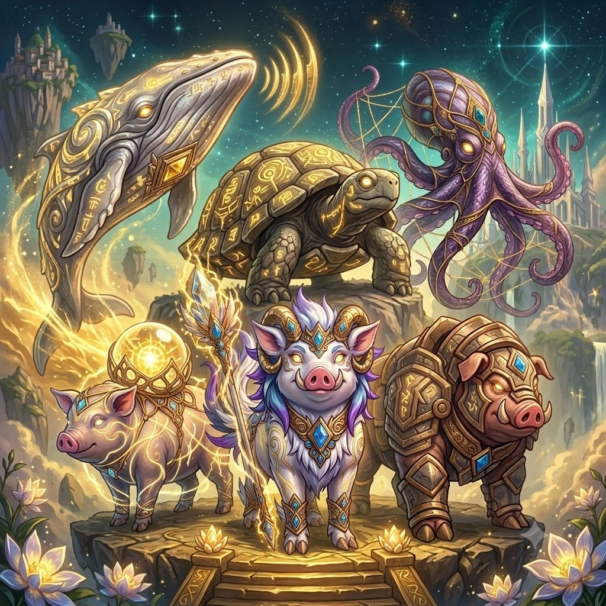
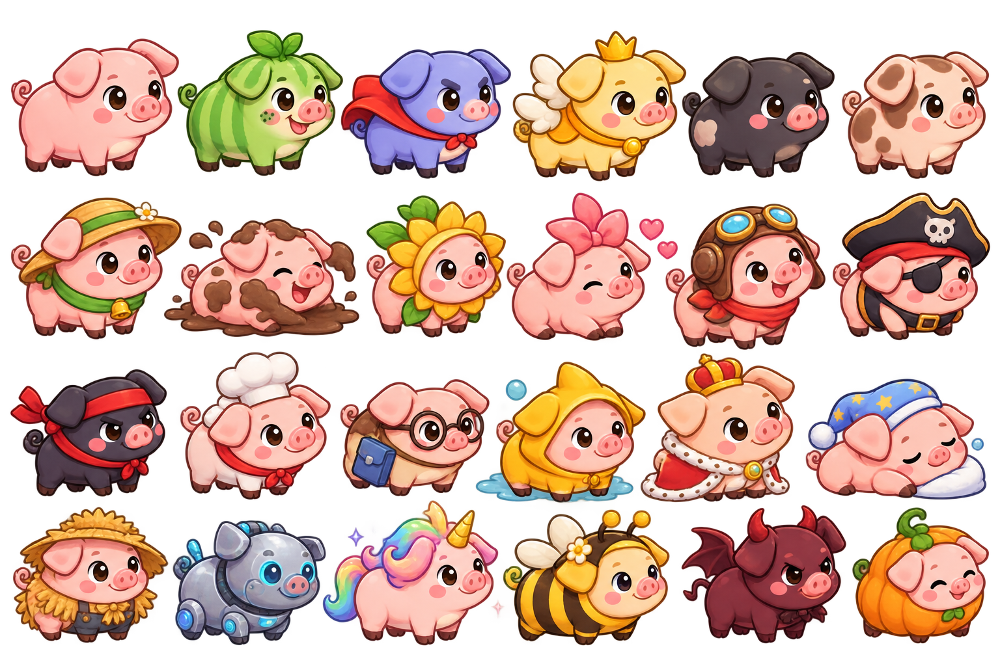

# First Guardians & Combat Animal hậu duệ — Thiết kế + bộ prompt Gemini

**Ngày:** 2026-10-14 · **Trạng thái:** đề xuất, chờ chủ dự án duyệt (các điểm cần chốt ở §0)

> **Cập nhật 2026-10-17:** chủ dự án duyệt các điểm 1–7 §0 trong decision 037 (9 nguyên tố, Gió → Sấm, Heo Hiệp Sĩ hệ Kim loại); 30 loài hậu duệ mới để sau. Unique / Ultimate chốt theo `docs/update_spec_sobi_adventure_gameplay_v1.md` §6.
**Nguồn:** lore `docs/lore/Lore_Sobi_World.md` (First Guardians, 9 Elements, Umbraflux), spec cập nhật `docs/UPDATE_SPEC_SOBI_ADVENTURE.md` §18–21 (9 nguyên tố, Poison là trạng thái, Void đặc biệt), dữ liệu combat hiện tại `content/adventure/{skills,archetypes}.json`, chuẩn hình `asset/GAME_ART_DIRECTION.md`.
**Phạm vi:** chỉ art + mô tả. Không đổi content/code. Loài, nguyên tố, skill ở đây là **đề xuất**; vào game cần decision mới (hệ 9 nguyên tố chưa được đưa vào Spec V2).

Ảnh tham khảo (đã lưu trong repo):

| File | Dùng làm |
|---|---|
|  `reference/sobi_adventure/first_guardians_concept.webp` | Ảnh AI render của chủ dự án: ý tưởng nhóm First Guardians |
| `art_inbox/.hints/adventure-01-guardians/*_hint.png` | Cắt từ ảnh concept bằng `art.py hint`, **chỉ dùng làm gợi ý hình dáng** (shape hint), đã đặt sẵn trong thư mục batch |
|  `reference/sobi_farm/style_reference_pigs.png` | **STYLE REFERENCE (image 1)** cho mọi sprite trong game |
| `reference/sobi_farm/style_reference_environment.png` | Style cho tranh minh họa (Track A) |

---

## 0. Điểm cần chốt

| # | Đề xuất | Vì sao |
|---|---|---|
| 1 | **Hai track art.** Track A "tranh truyền thuyết" (Codex, màn mở đầu, loading): được phép hoành tráng như ảnh concept nhưng hạ về bảng màu pastel ấm. Track B "sprite trong game": **bắt buộc** style Sobi Farm (chibi, viền nâu ấm, cel 2 tông, quay phải). | Ảnh concept rất đẹp nhưng là semi-realistic, nhiều chi tiết, mắt phát sáng: đặt cạnh heo Farm sẽ lệch hẳn style (decision 022: Farm là style chuẩn mọi Area). |
| 2 | **9 First Guardians, mỗi nguyên tố một vị.** Giữ 6 vị trong ảnh concept, thêm 3: Lửa (cua), Thiên nhiên (heo), Void (sứa). Tỉ lệ 4 heo / 5 sinh vật biển. | Khớp lore "9 Elements đầu tiên được ghi nhận trong First War" và spec 9 nguyên tố. |
| 3 | **Dark ≠ Umbra.** Guardian hệ Bóng tối dùng tím oải hương–chàm + chỉ bạc; màu **đen–tím than + magenta + vết nứt** chỉ dành cho sinh vật nhiễm Umbraflux. | Nếu không tách màu, người chơi sẽ tưởng bạch tuộc là phe ác. |
| 4 | **"Dấu Guardian"** chung cho cả dòng họ: vài đường xoáy vàng (hoa văn trừu tượng, **không** giống chữ) + một viên đá ngọc lam hình thoi ("Sobi Core"). Hậu duệ mang dấu nhỏ dần theo độ hiếm (§3.1). | Đọc được dòng dõi bằng mắt; bản Corrupted chỉ cần đổi dấu này (§5). Ảnh concept có ký tự giống chữ viết → vi phạm luật "no text". |
| 5 | Mắt Guardian trong sprite là **mắt nâu to có đốm sáng** như heo Farm. Mắt phát sáng trắng/vàng chỉ là FX khi tung Ultimate. | Mắt trắng trống đọc thành "bị điều khiển", trùng ngôn ngữ của Umbra. |
| 6 | Hệ Gió bị bỏ trong spec mới: 5 skill Gió hiện có chuyển sang **Sấm** (§4.2). Heo Hiệp Sĩ khởi đầu chuyển sang hệ **Kim loại** (hậu duệ Thiết Giáp). | Giữ lại skill đã cân bằng, chỉ đổi hệ. Cần decision + migration save. |
| 7 | Các tên tiếng Việt ở §2 và §3 là đề xuất; id tiếng Anh theo quy ước `pig_*` / `sea_*` / `guardian_*`. | |

---

## 1. Ngôn ngữ hình chung

### 1.1 Bảng màu 9 nguyên tố

| Hệ | Màu chủ (pastel, không neon) | Họa tiết nhận diện |
|---|---|---|
| Kim loại · Metal | đồng thau, bạc xám, viền vàng đồng | giáp tấm bo tròn, đinh tán |
| Thiên nhiên · Nature | xanh lá xô thơm, hồng hoa đào, kem | rêu, hoa nhỏ, chồi non, gai hoa hồng (độc) |
| Nước · Water | xanh ngọc lam, trắng bọt sóng | gợn sóng, bong bóng, vây mềm |
| Lửa · Fire | cam san hô, đỏ than ấm, hổ phách | vết nứt dung nham (vẽ, không phát sáng), búa rèn |
| Đất · Earth | xanh rêu ô liu, vàng cát, xám đá | đá cuội, núi nhỏ, cây thông tí hon |
| Sấm · Lightning | trắng bông, vàng bơ nhạt, xanh dừa cạn | hình zíc-zắc mềm, mây giông nhỏ |
| Bóng tối · Dark | oải hương–chàm, bạc ánh trăng | lưới chỉ bạc có nút sao, mực, giấc ngủ |
| Ánh sáng · Light | kem trắng, vàng ấm, hồng đào | đèn lồng, hoa sen, quầng sáng (FX) |
| Void · Neutral | trắng ngọc trai, viền ngũ sắc rất nhạt | bầu trời sao bên trong, xoắn ốc cổ |
| *Umbraflux (kẻ địch)* | *đen tím than, magenta* | *vết nứt, gân đen, đá ngọc nứt* |

### 1.2 Luật sprite (Track B, mọi sinh vật)
1. Style Sobi Farm (`GAME_ART_DIRECTION.md`): viền nâu ấm, cel 1 tông tối + 1 tông sáng, nắng trên-trái, khối tròn mũm mĩm, chi tiết thấp–vừa, đọc rõ ở 128 px.
2. Thân nhìn ngang **quay phải**, đầu xoay 3/4 về phía người xem. Heo: 4 móng chạm một đường đất. Sinh vật biển: vẽ **không có nước**, như đang lơ lửng.
3. Mắt to nâu sẫm hình bầu dục, một đốm trắng lớn; má hồng; miệng cười nhỏ. Sinh vật biển cũng có mặt dễ thương kiểu này.
4. Tối đa **một** khối phụ lớn (mai, giáp, mây, lồng đèn…), không che đầu.
5. Không glow, không hạt bay, không đổ bóng. Phần "phát sáng" vẽ bằng màu sáng, hiệu ứng làm sau bằng FX.
6. Sinh vật trong suốt (sứa) vẽ **đục như ngọc trai**, gợi trong suốt bằng tông sáng bên trong: nền xám cắt được, không bị lộ nền.
7. Guardian to và oai hơn hậu duệ một chút nhưng vẫn chibi. Không vũ khí cầm tay (heo không có tay): đạo cụ đeo trên lưng/đầu.

---

## 2. Chín First Guardians

Mỗi vị: lore ngắn · số phận hiện tại (móc vào gameplay) · tính cách · hình · 2 skill đặc trưng (đề xuất, dùng các trạng thái sẵn có khi được: atkUp, defUp, haste, slow, burn, stun, shield; trạng thái mới ghi *in nghiêng*).

### 2.1 Cá Ông Nam Hải — `guardian_whale` · Nước 🐋 *(có trong concept)*
- **Lore:** cá voi hát giữ nhịp thủy triều. Trong Great Fracture, nó cõng đàn sinh vật và con người vượt biển khi đất bị xé ra. Đây là gốc của tín ngưỡng **Cá Ông** cứu người đi biển ở Việt Nam.
- **Số phận:** ngủ sâu ở Đại Dương Sâu. Cá voi khổng lồ hiền ở nền Aquarium cấp 5 có thể chính là bóng của nó → gợi ý cho một nhiệm vụ.
- **Tính cách:** hiền, chậm rãi, che chở.
- **Hình:** cá voi lưng gù màu bạc ngọc trai, bụng kem có rãnh, xoáy vàng dọc lưng, đá ngọc lam gắn trên vây ngực. Các vòng sóng âm vàng trong concept → làm FX "tiếng hát", không vẽ vào sprite.
- **Skill:** *Khúc Ca Triều* (hồi máu cả đội + *xóa trạng thái xấu*) · *Sóng Thần Cổ* (mọi kẻ địch, sát thương Nước + slow).

### 2.2 Quy Sơn – Rùa Mang Núi — `guardian_turtle` · Đất 🐢 *(có trong concept)*
- **Lore:** cõng cả một ngọn núi trên mai để chặn lối ra của The Hollow trong trận cuối.
- **Số phận:** **hóa thành đảo**: một trong những đảo của Sobi World chính là mai của nó (gợi ý: Đảo Sảnh).
- **Tính cách:** trầm, kiên nhẫn, lì đòn.
- **Hình:** rùa xanh ô liu, mai vòm cao như quả núi bo tròn: mảng rêu, vài hòn cuội, một cây thông tí hon trên đỉnh; xoáy vàng trên vảy mai, ngọc lam trên trán.
- **Skill:** *Mai Núi* (cả đội defUp + shield) · *Địa Chấn Cổ* (mọi kẻ địch, Đất + stun).

### 2.3 Dạ Mặc – Bạch Tuộc Dệt Đêm — `guardian_octopus` · Bóng tối 🐙 *(có trong concept)*
- **Lore:** Bóng tối của Dạ Mặc là **đêm và giấc ngủ**, không phải Umbra. Nó dệt lưới đêm cho sinh vật được nghỉ ngơi. Trong trận cuối, chính lưới chỉ của nó buộc phong ấn lại.
- **Số phận:** phong ấn yếu đi vì **chỉ của Dạ Mặc đang sờn** → móc thẳng vào endgame "hồi phục phong ấn".
- **Tính cách:** bí ẩn, dịu dàng, biết nhiều về Umbra nhất.
- **Hình:** bạch tuộc oải hương–chàm, đầu tròn, 8 xúc tu cuộn; hai xúc tu nâng một tấm lưới chỉ bạc thưa có nút hình ngôi sao; xoáy vàng trên đầu, ngọc lam trên trán. Bỏ tông tím đỏ của concept để không lẫn với Umbra.
- **Skill:** *Lưới Đêm* (mọi kẻ địch slow + có thể stun) · *Màn Mực* (cả đội shield, kế thừa *Màn Sương* hiện có).

### 2.4 Quang Trư – Heo Mang Đèn — `guardian_light_pig` · Ánh sáng 🐷💡 *(có trong concept)*
- **Lore:** cõng mảnh vỡ của **Tia Sáng Đầu Tiên** (Lumina) trong một lồng đèn. Ánh đèn dẫn sinh vật lạc đường về nhà → nguồn gốc của đèn lồng Trung Thu.
- **Số phận:** hóa thành ngọn đèn cổ trong Tàn Tích. Người chơi thắp lại đèn này để mở vùng sâu hơn.
- **Tính cách:** ấm áp, lạc quan, người dẫn đường.
- **Hình:** heo trắng kem má vàng ấm; trên lưng là quả cầu đèn tròn đặt trong đài hoa sen vàng (vẽ vàng nhạt, không phát sáng); vương miện cánh sen nhỏ có ngọc lam; xoáy vàng hai bên sườn.
- **Skill:** *Ánh Sáng Đầu Tiên* (hồi máu một đồng đội + *xóa trạng thái xấu*) · *Tia Lumina* (một kẻ địch, Ánh sáng, mạnh hơn với địch nhiễm Umbraflux).

### 2.5 Lôi Dương – Heo Sừng Gọi Sấm — `guardian_thunder_pig` · Sấm 🐏⚡ *(trung tâm concept)*
- **Lore:** Guardian **thức tỉnh đầu tiên**. Tiếng sấm của nó là hiệu lệnh gọi mọi đàn tập hợp, mở đầu First War. Là thủ lĩnh của chín vị.
- **Số phận:** ngủ trên một ngọn núi bay. Gợi ý: đàn heo mây và giông ở Sobi Cloud là hậu duệ.
- **Tính cách:** dũng cảm, nhanh nhẹn, có uy.
- **Hình:** heo trắng lông xù, bờm oải hương–xanh dừa cạn chảy xuống cổ, cặp sừng cừu vàng cuộn, băng trán vàng gắn ngọc lam, vòng cổ chân vàng; một cây gậy gỗ ngắn đầu tinh thể vàng zíc-zắc và hai lông vũ trắng **đeo chéo sau lưng** (heo không cầm được gậy).
- **Skill:** *Gọi Sấm* (mọi kẻ địch, Sấm + có thể stun) · *Tốc Lôi* (cả đội haste, kế thừa *Gió Đuôi*).

### 2.6 Thiết Giáp – Heo Rừng Giáp Đồng — `guardian_metal_boar` · Kim loại 🐗🛡️ *(có trong concept)*
- **Lore:** bức tường khiên của First War. Bộ giáp do Hỏa Giải rèn (§2.7).
- **Số phận:** hóa đá, đứng canh cổng phong ấn. Gợi ý: một trùm Tàn Tích là tượng Thiết Giáp **bị Umbraflux chiếm** → thắng xong thì thanh tẩy.
- **Tính cách:** nghiêm, trung thành, ít nói. Tổ tiên của **Heo Hiệp Sĩ** khởi đầu.
- **Hình:** heo rừng nâu hạt dẻ chắc nịch, hai răng nanh kem ngắn bo tròn, giáp tấm đồng bo tròn ở lưng, vai và chân, đinh tán đồng thau, ngọc lam trên giáp ngực, viền bạc xám.
- **Skill:** *Tường Khiên Đồng* (tự defUp + *khiêu khích*: địch phải đánh nó) · *Húc Thép* (một kẻ địch, sát thương rất lớn + stun).

### 2.7 Hỏa Giải – Cua Lò Rèn — `guardian_forge_crab` · Lửa 🦀🔥 *(mới)*
- **Lore:** sống ở miệng núi lửa dưới đáy biển. Rèn giáp cho Thiết Giáp và rèn đinh khóa của phong ấn.
- **Số phận:** **vẫn đang rèn** dưới đáy biển. Gợi ý NPC/sự kiện hiếm: tìm thấy Hỏa Giải → mở cấp trang bị cổ.
- **Tính cách:** nóng tính nhưng tốt bụng, thợ cả.
- **Hình:** cua tròn to màu cam san hô, mai đỏ than có đường nứt hổ phách như dung nham nguội (vẽ, không phát sáng), một càng to hẳn hình búa rèn, tấm đồng nhỏ hình đe trên lưng, ngọc lam giữa hai cuống mắt.
- **Skill:** *Càng Nung* (một kẻ địch, Lửa + burn) · *Phun Dung Nham* (mọi kẻ địch, Lửa + burn).

### 2.8 Mộc Mẫu – Heo Mẹ Rừng Hoa — `guardian_bloom_sow` · Thiên nhiên 🐖🌸 *(mới)*
- **Lore:** mẹ của mọi giống heo nông trại. Sau chiến tranh, bà gieo lại rừng. Hạt giống hiếm ở Garden là "hạt của Mộc Mẫu".
- **Số phận:** ngủ cắm rễ dưới Rừng Thì Thầm. Twist tùy chọn: trùm **Cổ Thụ Giận Dữ** hiện có chính là rễ của bà bị Umbraflux nhiễm.
- **Tính cách:** bao dung, chậm, giận thì đáng sợ.
- **Hình:** heo mẹ to hiền màu xanh xô thơm, lưng phủ rêu mềm mọc hoa nhỏ hồng–trắng, cỏ ba lá và một cây non; vương miện lá có ngọc lam; đuôi xoăn kết thúc bằng một nụ hồng gai tím-xanh (độc là **trạng thái** gốc Nature, đúng spec §19).
- **Skill:** *Gai Độc* (một kẻ địch, Thiên nhiên + *poison*) · *Hoa Hồi Sinh* (cả đội *hồi máu mỗi lượt*).

### 2.9 Hư Không – Sứa Vô Định — `guardian_void_jelly` · Void ✨ *(mới)*
- **Lore:** vị duy nhất từng chạm vào cả Lumina lẫn Umbra mà không thuộc về bên nào. Trong lore gốc, đây là Guardian **"không bao giờ được tìm thấy"**.
- **Số phận:** bí mật endgame. Thỉnh thoảng có tin đồn về một con sứa mang bầu trời sao trong mình.
- **Tính cách:** tĩnh lặng, khó đoán, trung lập.
- **Hình:** sứa lớn trắng ngọc trai, chuông tròn, bên trong chuông là một bầu trời đêm tí hon với vài chấm sao; viền chuông ánh ngũ sắc rất nhạt (bạc hà, hồng, tím); xúc tu dải lụa dài uốn cong; xoáy vàng trên đỉnh chuông và ngọc lam ở đỉnh; hai mắt nâu to trên chuông.
- **Skill:** *Va Chạm Thuần* (sát thương Void, bỏ qua khắc chế, sức mạnh vừa phải theo spec §21) · *Màn Hư Vô* (*xóa mọi trạng thái* của cả hai phe).

---

## 3. Combat Animal hậu duệ (đề xuất 43 loài)

### 3.1 Luật dòng dõi và độ hiếm
- **Thường:** không có dấu, 1 hệ. **Khá:** một chấm ngọc lam nhỏ. **Hiếm:** ngọc lam nhỏ + một đường xoáy vàng, 1 hệ. **Sử thi:** ngọc lam + 2–3 xoáy vàng, 1–2 hệ. **Huyền thoại:** ngọc lam + viền/giáp vàng, 2 hệ, là hậu duệ trực tiếp (bản thu nhỏ của Guardian).
- Mỗi loài mang **một chi tiết** của tổ tiên (sừng cừu, mai núi, lưới bạc, lồng đèn…) để người chơi tự nhận ra dòng họ.
- Cột "Có sẵn" = loài đã có trong game. Heo có sẵn hiện được map kiểu đánh theo họ; hệ mới ghi ở đây là đề xuất.

### 3.2 Bảng hậu duệ

| Dòng | id | Tên | Loài | Hệ | Độ hiếm | Vai trò | Có sẵn | Nét nhận diện |
|---|---|---|---|---|---|---|---|---|
| Nam Hải | `sea_bubble_shrimp` | Tôm Bong Bóng | tôm | Nước | Thường | hỗ trợ | | tôm xanh nhạt, thổi chuỗi bong bóng |
| Nam Hải | `fish_angelfish` | Cá Thiên Thần | cá | Nước | Khá | hồi máu | ✓ | |
| Nam Hải | `sea_dolphin_singer` | Cá Heo Ca Sĩ | cá heo | Nước | Hiếm | hỗ trợ | | cá heo xanh ngọc, vây có vòng xoáy vàng |
| Nam Hải | `pig_tide` | Heo Sóng | heo | Nước | Hiếm | pháp sư | | heo xanh ngọc đội mũ vỏ sò, bờm như bọt sóng |
| Nam Hải | `sea_whale_calf` | Cá Voi Con Ca Triều | cá voi | Nước / Ánh sáng | Huyền thoại | hồi máu | | Nam Hải thu nhỏ, bạc ngọc trai, vây viền vàng |
| Quy Sơn | `sea_moss_turtle` | Rùa Rêu Con | rùa | Đất | Thường | chịu đòn | | rùa nhỏ, mai phủ rêu |
| Quy Sơn | `sea_hermit_crab` | Ốc Mượn Hồn Vỏ Đá | ốc mượn hồn | Đất | Thường | chịu đòn | | sống trong vỏ ốc bằng đá cuội |
| Quy Sơn | `sea_sand_star` | Sao Biển Cát | sao biển | Đất | Khá | hỗ trợ (giáp) | | sao biển vàng cát, chấm sỏi |
| Quy Sơn | `pig_mudstone` | Heo Đá Bùn | heo | Đất | Khá | man lực | | heo nâu đất, lưng có mảng đá |
| Quy Sơn | `sea_island_turtle` | Rùa Đảo Nhỏ | rùa | Đất / Thiên nhiên | Sử thi | chịu đòn | | trên mai là một hòn đảo tí hon có cây dừa |
| Dạ Mặc | `sea_ink_octopus` | Bạch Tuộc Mực Tím | bạch tuộc | Bóng tối | Thường | quỷ kế | | bạch tuộc tím nhạt, phun mực |
| Dạ Mặc | `sea_night_squid` | Mực Ống Đêm | mực | Bóng tối | Hiếm | thích khách | | mực ống chàm, đốm bạc như sao |
| Dạ Mặc | `fish_lanternfish` | Cá Đèn Lồng | cá | Bóng tối | Hiếm | khống chế | ✓ (chưa đánh được) | đề xuất cho đánh được |
| Dạ Mặc | `pig_ninja` | Heo Ninja | heo | Bóng tối | Hiếm | thích khách | ✓ (style ref) | |
| Dạ Mặc | `sea_dream_octopus` | Bạch Tuộc Dệt Mộng | bạch tuộc | Bóng tối / Void | Sử thi | khống chế | | cầm một túm lưới bạc nhỏ có nút sao |
| Quang Trư | `fish_glowfish` | Cá Phát Sáng | cá | Ánh sáng | Khá | pháp sư | ✓ | đổi từ Gió sang Ánh sáng |
| Quang Trư | `pig_angel` | Heo Thiên Thần | heo | Ánh sáng | Khá | hồi máu | có trong style ref, chưa có sprite | heo vàng có cánh nhỏ và vương miện |
| Quang Trư | `pig_lantern` | Heo Đèn Lồng | heo | Ánh sáng | Hiếm | hỗ trợ | | đèn lồng ông sao Trung Thu đeo trên lưng |
| Quang Trư | `sea_pearl_clam` | Trai Ngọc | trai | Ánh sáng | Hiếm | khiên | | vỏ trai hé mở, ngọc trai kem |
| Quang Trư | `fish_moonfish` | Cá Trăng | cá | Ánh sáng / Nước | Sử thi | hồi máu | ✓ | |
| Lôi Dương | `pig_storm_cloud` | Heo Mây Giông | heo | Sấm | Khá | triệu bão | | heo trắng đội một đám mây giông nhỏ |
| Lôi Dương | `sea_mantis_shrimp` | Tôm Tít Sấm | tôm tít | Sấm | Hiếm | thích khách | | tôm tít sặc sỡ pastel, càng đấm tia chớp |
| Lôi Dương | `sea_electric_eel` | Cá Chình Điện | cá chình | Sấm | Hiếm | pháp sư | | chình vàng bơ, vằn zíc-zắc |
| Lôi Dương | `sea_spark_ray` | Cá Đuối Tia Chớp | cá đuối | Sấm / Nước | Sử thi | triệu bão | | đuối xanh dừa cạn, viền cánh zíc-zắc |
| Lôi Dương | `pig_ram_thunder` | Heo Sừng Sấm Con | heo | Sấm / Ánh sáng | Huyền thoại | chiến binh | | Lôi Dương nhí: sừng cừu nhỏ, bờm tím |
| Thiết Giáp | `pig_knight` | Heo Hiệp Sĩ | heo | Kim loại | Khá | chiến binh | ✓ (heo khởi đầu) | vẽ lại: bản code-drawn bị loại (OUTLIER) |
| Thiết Giáp | `sea_iron_urchin` | Nhím Biển Gai Sắt | nhím biển | Kim loại | Thường | phản đòn | | nhím tròn, gai bạc bo tròn đầu |
| Thiết Giáp | `pig_robot` | Heo Robot | heo | Kim loại | Hiếm | chịu đòn | ✓ (style ref) | |
| Thiết Giáp | `sea_silver_lobster` | Tôm Hùm Giáp Bạc | tôm hùm | Kim loại | Hiếm | chiến binh | | tôm hùm giáp bạc, viền đồng |
| Thiết Giáp | `sea_king_crab` | Cua Hoàng Đế Giáp | cua | Kim loại / Đất | Sử thi | chịu đòn | | cua to, giáp đồng có đinh tán |
| Hỏa Giải | `sea_ember_crab` | Cua Lửa Con | cua | Lửa | Thường | chiến binh | | cua cam nhỏ, vết nứt hổ phách |
| Hỏa Giải | `sea_cherry_shrimp` | Tôm Đỏ Than | tôm | Lửa | Thường | thích khách | | tôm đỏ anh đào, đuôi như ngọn lửa |
| Hỏa Giải | `pig_pepper` | Heo Ớt | heo | Lửa | Khá | pháp sư lửa | | heo đỏ đội cuống ớt xanh |
| Hỏa Giải | `fish_betta` | Cá Betta Lụa | cá | Lửa | Hiếm | thích khách | ✓ | đổi từ Gió sang Lửa |
| Hỏa Giải | `fish_dragon_koi` | Koi Rồng | cá | Lửa / Nước | Sử thi | chiến binh | ✓ | |
| Mộc Mẫu | `pig_watermelon` | Heo Dưa Hấu | heo | Thiên nhiên | Thường | chịu đòn | ✓ (style ref) | |
| Mộc Mẫu | `fish_pufferfish` | Cá Nóc | cá | Thiên nhiên | Khá | quỷ kế (độc) | ✓ | |
| Mộc Mẫu | `sea_nudibranch` | Sên Biển Hoa | sên biển | Thiên nhiên | Hiếm | pháp sư (độc) | | sên biển pastel có "hoa" trên lưng |
| Mộc Mẫu | `fish_seahorse` | Cá Ngựa Rong | cá ngựa | Thiên nhiên / Nước | Sử thi | hồi máu | ✓ (chưa đánh được) | thân có lá rong như rồng biển lá |
| Hư Không | `sea_crystal_jelly` | Sứa Pha Lê | sứa | Void | Thường | pháp sư | | sứa nhỏ trắng ngọc trai |
| Hư Không | `sea_moon_jelly` | Sứa Trăng Tròn | sứa | Void | Khá | hỗ trợ (xóa trạng thái) | | 4 vòng tròn nhạt trên chuông |
| Hư Không | `sea_nautilus` | Ốc Anh Vũ Vô Định | ốc anh vũ | Void / Đất | Sử thi | chịu đòn | | vỏ xoắn kem có sọc ngũ sắc nhạt |
| Hư Không | `pig_nebula` | Heo Tinh Vân | heo | Void / Ánh sáng | Huyền thoại | pháp sư | | heo xanh đêm, lông có đốm sao và vệt tinh vân pastel |

Ghi chú: 43 loài = 30 loài mới (7 heo + 23 sinh vật biển) + 13 loài có sẵn. Cần vẽ 32 sprite ở §6 D1–D4: 30 loài mới + vẽ lại Heo Hiệp Sĩ + Cá Ngựa bản đánh được. Các loài có sẵn khác chỉ cần đổi hệ. Riêng Heo Thiên Thần mới có trong ảnh style ref, chưa có sprite trong game: cắt từ ảnh ref hoặc thêm vào một batch heo sau.

---

## 4. Liên hệ với skill hiện tại

### 4.1 Kiểu đánh ↔ dòng Guardian
| Kiểu đánh hiện tại (`archetypes.json`) | Hệ hiện tại | Đề xuất dòng / hệ mới |
|---|---|---|
| Chiến binh `bruiser` | Lửa | Hỏa Giải (Lửa) hoặc Thiết Giáp (Kim loại) |
| Hộ vệ `guardian` | Đất | Quy Sơn (Đất) |
| Thích khách `skirmisher` | Gió | Lôi Dương (Sấm) |
| Pháp sư nước `mystic` | Nước | Nam Hải (Nước) |
| Pháp sư lửa `pyromancer` | Lửa | Hỏa Giải (Lửa) |
| Triệu bão `stormcaller` | Gió | Lôi Dương (Sấm) |
| Man lực `brute` | Đất | Quy Sơn (Đất) |
| Quỷ kế `trickster` | Nước | Dạ Mặc (Bóng tối) |
| *(mới)* | — | Mộc Mẫu (Thiên nhiên, độc), Quang Trư (Ánh sáng, hồi), Thiết Giáp (Kim loại, khiêu khích), Hư Không (Void) |

### 4.2 Skill
- 5 skill Gió (Cú Quật Gió, Loạt Đòn Nhanh, Gió Đuôi, Lốc Xoáy, Gió Lưỡi Dao) → đổi tên và hệ sang Sấm (Cú Quật Sấm, Loạt Đòn Chớp, Tốc Lôi, Lốc Giông, Lưỡi Sét), giữ nguyên số.
- 5 hệ mới, mỗi hệ cần khoảng 5 skill (≈ 25 skill) + 18 skill đặc trưng của Guardian (§2).
- Trạng thái mới cần có: *poison* (Nature), *xóa trạng thái*, *khiêu khích*, *hồi máu mỗi lượt*, *sát thương thuần* (Void).

---

## 5. Biến thể bị Umbraflux nhiễm (kẻ địch)

Lore: một sinh vật bình thường bị nhiễm sẽ thành Umbra → Corrupted → Abyssal. Không cần vẽ quái mới hoàn toàn: **lấy sprite đã duyệt rồi sửa** (prompt E1, §6). Luật hình:
- Xoáy vàng → gân nứt tím đen; ngọc lam → ngọc magenta nứt.
- Thân xỉn đi khoảng 30% về phía xám tím. Mày nhíu giận, mắt magenta đồng tử nhỏ.
- Vẫn dễ đọc, không ghê rợn, không máu me (game cho mọi lứa tuổi).

---

## 6. Bộ prompt Gemini → batch `adventure-01-guardians`

Prompt được dựng bằng skill `image-to-prompt`. **Nguồn sự thật là manifest**, không viết prompt tay ở file này:

- Manifest: `art_inbox/.batch/adventure-01-guardians/batch.json` (sửa ở đây rồi chạy `prep` lại)
- Prompt để dán: `art_inbox/.batch/adventure-01-guardians/PROMPT.md` (file sinh ra, không sửa tay)
- File đính kèm đã đặt sẵn trong cùng thư mục (`1_style_creature.png`, `1_style_scene.png`, `G1_2_hint.png`…)

| Sheet | Nội dung | Lưới | Asset |
|---|---|---|---|
| G1 | 4 Guardian heo (gợi ý hình từ concept) | 2×2 | `guardian_light_pig`, `guardian_thunder_pig`, `guardian_metal_boar`, `guardian_bloom_sow` |
| G2 | 3 Guardian biển (gợi ý hình từ concept) | 1×3 | `guardian_whale`, `guardian_turtle`, `guardian_octopus` |
| G3 | 2 Guardian mới | 1×2 | `guardian_forge_crab`, `guardian_void_jelly` |
| D1 | 8 hậu duệ heo | 2×4 | `pig_*` |
| D2 | 8 giáp xác | 2×4 | `sea_*` |
| D3 | 8 thân mềm | 2×4 | `sea_*` |
| D4 | 8 cá và sinh vật lớn | 2×4 | `sea_*`, `fish_seahorse` |
| A1 | Tranh truyền thuyết 9 Guardian (full-bleed) | 1 | `bg_first_guardians` |

Sau khi lưu ảnh từ Gemini vào thư mục batch:

```bash
python .claude/skills/image-to-prompt/scripts/art.py cut adventure-01-guardians
```

```bash
python .claude/skills/image-to-prompt/scripts/art.py check adventure-01-guardians
```

**Để batch sau** (cần sprite đã duyệt làm ảnh nguồn):
- Chân dung Codex cho từng Guardian (Track A), dùng sprite G1–G3 đã duyệt làm ảnh `accepted`, phông nền theo §2.
- Biến thể Umbraflux (`mode: edit` trên sprite đã duyệt, luật ở §5): Corrupted rồi Abyssal.

---

## 7. Kiểm tra nhanh khi nhận ảnh

- [ ] Viền nâu ấm, không đen; cel 2 tông; nắng trên-trái.
- [ ] Quay phải, đầu 3/4, heo 4 móng chung một đường đất; đầu nhỏ hơn thân.
- [ ] Mắt nâu có đốm sáng: không trắng trống, không phát sáng.
- [ ] Xoáy vàng là hoa văn, **không giống chữ**; ngọc lam đúng mức theo độ hiếm (§3.1).
- [ ] Không glow, không hạt bay, không nước/bong bóng trừ khi prompt ghi rõ "part of the sprite".
- [ ] Nền xám `#C8C8C8` phẳng, các ô cách xa nhau (cắt được).
- [ ] Hệ Bóng tối không lẫn màu Umbraflux (không magenta, không gân đen).
- [ ] Đọc rõ khi thu về 128 px.
